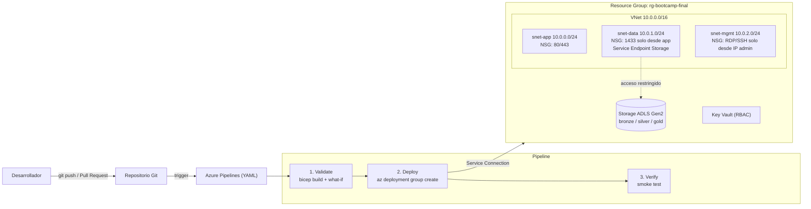

# Proyecto final – Bootcamp Azure: Infraestructura como código con red segura, almacenamiento y CI/CD

Infraestructura de Azure definida 100 % como código (**Bicep**) y desplegada automáticamente con **Azure Pipelines** (Azure DevOps). Integra los temas vistos en el bootcamp: Azure CLI y control de costos, redes (VNet, subredes, NSG), almacenamiento (ADLS Gen2), seguridad con Key Vault/RBAC y CI/CD con pipelines YAML.

## Arquitectura



## Recursos desplegados

| Recurso | Nombre | Detalle |
|---|---|---|
| Resource Group | `rg-bootcamp-final` | Agrupa todo y facilita el control de costos / limpieza |
| Virtual Network | `vnet-bootc-dev` | `10.0.0.0/16` |
| Subredes | `snet-app`, `snet-data`, `snet-mgmt` | `10.0.0.0/24`, `10.0.1.0/24`, `10.0.2.0/24` |
| NSG (x3) | `nsg-bootc-app/data/mgmt-dev` | Un NSG por subred, con regla final *Deny-All-Inbound* |
| Storage Account | `stbootcdev<hash>` | StorageV2, LRS, namespace jerárquico (ADLS Gen2), TLS 1.2, sin acceso público, red restringida a `snet-data` |
| Contenedores | `bronze`, `silver`, `gold` | Arquitectura medallion |
| Key Vault | `kv-bootc-dev-<hash>` | Autorización RBAC, soft delete 7 días |

## Estructura del repositorio

```
.
├── azure-pipelines.yml        # Pipeline YAML: Validate -> Deploy -> Verify
├── infra/
│   ├── main.bicep             # Orquesta los módulos
│   └── modules/
│       ├── network.bicep      # VNet + subredes + NSG
│       ├── storage.bicep      # Storage ADLS Gen2 + contenedores
│       └── keyvault.bicep     # Key Vault con RBAC
├── scripts/
│   ├── deploy.sh              # Despliegue manual en Cloud Shell
│   └── cleanup.sh             # Elimina el Resource Group
└── docs/evidencias/           # Capturas del despliegue
```

## Temas del bootcamp aplicados

| Tema | Cómo se aplica en el proyecto |
|---|---|
| **Azure CLI y Cloud Shell** | `scripts/deploy.sh` y las tareas `AzureCLI@2` del pipeline usan `az group`, `az deployment group`, `az network`, `az storage`, `az keyvault` |
| **Resource Groups y etiquetas (tags)** | Todo vive en un RG con tags `proyecto`, `entorno`, `gestionadoPor` |
| **Control de costos** | Recursos de costo casi nulo (sin VMs, Firewall ni IP pública), presupuesto con alerta en Cost Management y script de limpieza |
| **Redes** | VNet `10.0.0.0/16`, tres subredes segmentadas (app / data / mgmt) sin solapamiento de rangos |
| **Seguridad de red (NSG)** | NSG por subred con reglas mínimas, prioridades explícitas y *Deny-All-Inbound*; administración solo desde una IP de origen |
| **Almacenamiento (ADLS Gen2)** | Namespace jerárquico, contenedores bronze/silver/gold, TLS 1.2, acceso público deshabilitado y Service Endpoint desde `snet-data` |
| **Key Vault + RBAC** | Vault con `enableRbacAuthorization`, preparado para secretos sin hardcodearlos en código |
| **Infraestructura como código (Bicep)** | Módulos reutilizables y parametrizados (`envName`, `prefix`, `adminSourceIp`) |
| **Azure DevOps / CI/CD** | Pipeline como código con stages `Validate → Deploy → Verify`, `dependsOn`, `what-if`, environment y smoke test |
| **Buenas prácticas** | Menor privilegio, secretos fuera del repo, validación antes de desplegar, PR con build validation |

## Cómo desplegar

### Opción A – Azure Pipelines
1. Crear proyecto en Azure DevOps y una *Service Connection* de tipo Azure Resource Manager llamada `sc-azure-bootcamp` apuntando a la suscripción.
2. Editar `adminSourceIp` en `azure-pipelines.yml` con tu IP pública (`x.x.x.x/32`).
3. Crear el pipeline desde el repositorio (`azure-pipelines.yml` existente) y ejecutarlo.

### Opción B – Azure Cloud Shell
```bash
git clone <URL-del-repo> && cd azure-bootcamp-final
ADMIN_IP="x.x.x.x/32" bash scripts/deploy.sh
```

### Limpieza
```bash
bash scripts/cleanup.sh
```

## Evidencias

Capturas del pipeline en verde, de los recursos en el portal y de la salida del smoke test en `docs/evidencias/`.

## Costos

VNet, subredes y NSG no tienen costo. Storage LRS y Key Vault generan centavos con uso de laboratorio. No se despliegan VMs, Azure Firewall, Bastion ni IPs públicas.

## Estado de ejecución

- La infraestructura se desplegó y verificó desde Azure Cloud Shell con `scripts/deploy.sh` en la región `brazilsouth`, una de las permitidas por la política de Azure for Students (ver capturas en `docs/evidencias/`).
- `azure-pipelines.yml` define el pipeline Validate → Deploy → Verify. No se ejecutó porque la cuenta institucional (tenant universitario) no permitió crear la organización de Azure DevOps: el asistente no detecta la suscripción. El pipeline queda listo para correr al crear una Service Connection llamada `sc-azure-bootcamp`.
